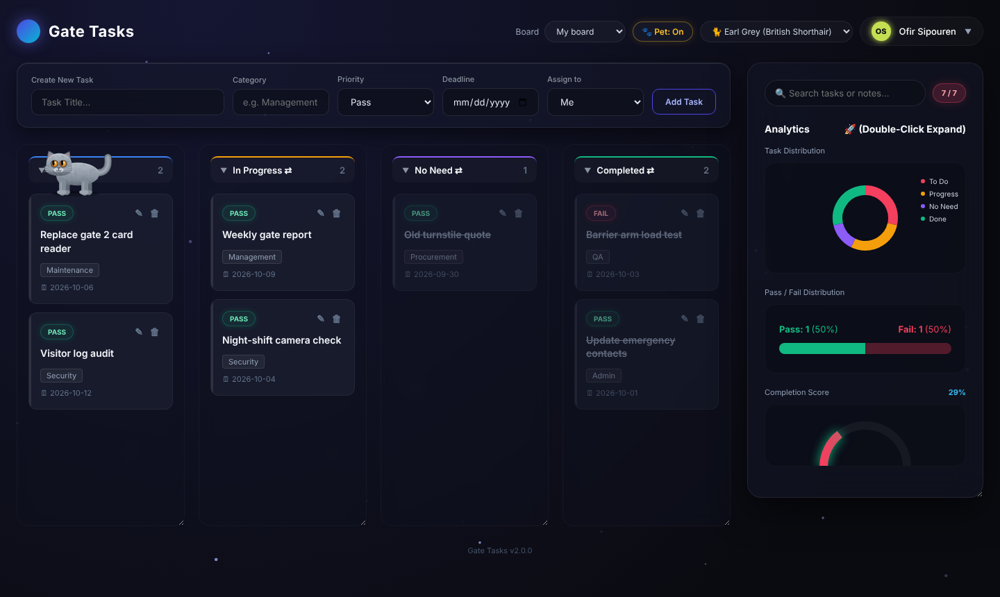
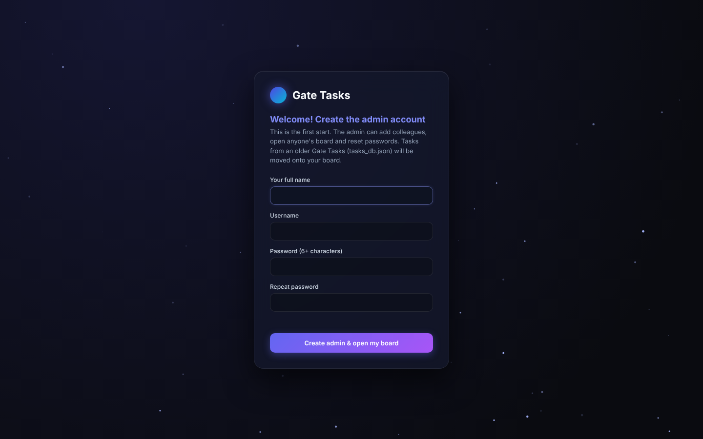
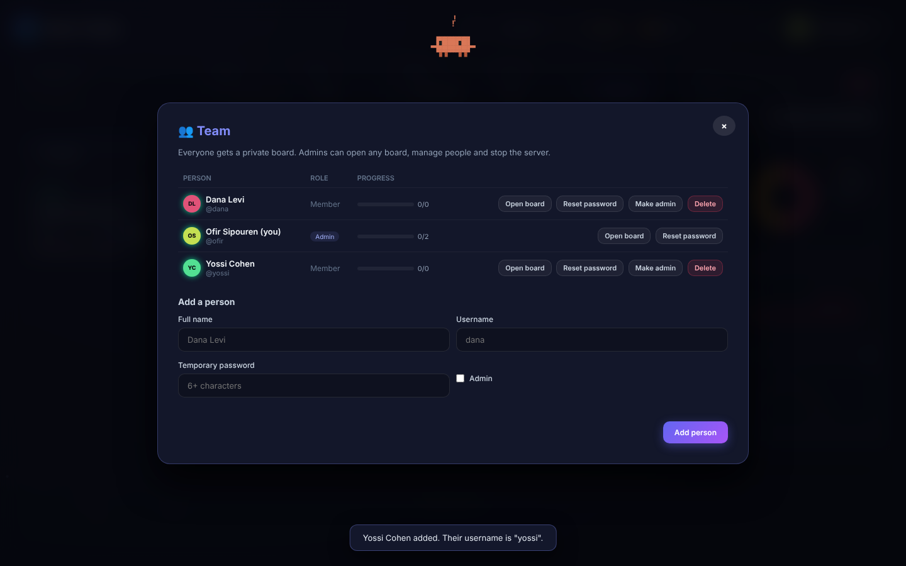

# Gate Tasks

A small, self-hosted task manager for the office. Every person signs in to a **private board**, can hand tasks to colleagues, and tracks **Pass / Fail** results through *To Do → In Progress → No Need → Completed*. It runs on one PC with Python, keeps everything in a single SQLite file, and needs no cloud account.



## Features

- **A board per person.** Sign in with a username and password and see only your own tasks.
- **Hand-offs.** Assign a task to a colleague and it lands on their board, marked "from &lt;you&gt;".
- **Admins** add and remove people, reset passwords, open anyone's board, see everyone's progress and stop the server from the browser.
- **Kanban.** Drag tasks between columns, drag columns to reorder, click to fold a column, double-click for a deep-dive.
- **Notes.** Double-click a card for a notes log. Search covers titles, categories and notes.
- **Analytics.** Status donut, Pass/Fail split, completion gauge, overdue count and a category breakdown.
- **Fun.** Confetti on a Pass, a shake on a Fail, a starfield, and a desktop pet that walks on the board. Pick the pet: Clawd, Amir Latex, or Earl Grey the British Shorthair. There are also a couple of easter eggs.
- **Safe defaults.** Passwords are hashed with PBKDF2, sessions are HttpOnly cookies, failed sign-ins are rate-limited, and everything you type is escaped before it's shown.

| First start | Team management |
| --- | --- |
|  |  |

## Quick start (Windows)

1. Install [Python 3.10+](https://www.python.org/downloads/) and tick **"Add python.exe to PATH"**.
2. Double-click **`install_requirements.bat`** once.
3. Double-click **`Start_Gate_Tasks.bat`**. Your browser opens at <http://127.0.0.1:8000>.
4. On the first start, create the **admin** account. Then go to *your name → Manage team* to add colleagues.

## Quick start (any OS)

```bash
python -m pip install -r requirements.txt
python Gate_Tasks.py
```

## Using it across the office

By default Gate Tasks only listens on this PC. To let colleagues use it from their own computers:

- Double-click **`Start_Gate_Tasks_Office_LAN.bat`**, or set `GATE_TASKS_HOST=0.0.0.0`.
- Allow Python through Windows Firewall when Windows asks.
- Colleagues open `http://<this-pc-name>:8000`. Each person signs in with the account the admin created for them.

> It serves plain HTTP. That's fine on a trusted office network, but don't expose it to the internet as-is.

## Settings

All settings are environment variables and all are optional.

| Variable | Default | What it does |
| --- | --- | --- |
| `GATE_TASKS_HOST` | `127.0.0.1` | Address to listen on (`0.0.0.0` = whole network) |
| `GATE_TASKS_PORT` | `8000` | Port |
| `GATE_TASKS_DATA_DIR` | `./data` | Where the database lives |
| `GATE_TASKS_PET` | `1` | `0` removes the desktop pet for everyone |
| `GATE_TASKS_OPEN_BROWSER` | `1` | Open the browser on start |
| `GATE_TASKS_HIDE_CONSOLE` | `1` | Hide the console window on Windows (stop the server from *your name → Stop server*) |

## Your data

Everything is stored in **`data/gate_tasks.db`**. To back up, copy that file while the app is stopped. The `data/` folder is in `.gitignore`, so your tasks never end up on GitHub.

**Upgrading from v1** (the single-file `tasks_db.json` version): put `tasks_db.json` next to `Gate_Tasks.py` before the first start. The tasks move onto the admin's board when the admin account is created.

## Project layout

```
Gate_Tasks.py                 entry point
gate_tasks/
  app.py                      FastAPI routes: pages, auth, people, tasks
  db.py                       SQLite schema and queries
  security.py                 password hashing, session tokens
  config.py                   settings (environment variables)
  main.py                     launcher (uvicorn + browser)
  static/                     login/board pages, CSS, JS, desktop pet
tests/test_api.py             API tests
ci/tests.yml                  GitHub Actions workflow (move to .github/workflows/)
```

## Development

```bash
python -m pip install -r requirements-dev.txt
python -m pytest
```

A GitHub Actions workflow that runs the tests on Windows and Linux is ready in `ci/tests.yml`. Move it to `.github/workflows/tests.yml` to turn it on.

## Credits & license

MIT, see [LICENSE](LICENSE). The desktop pet engine comes from [desktop-pet-skill](https://github.com/louzinio/desktop-pet-skill) (MIT). Earl Grey the British Shorthair skin was made for Gate Tasks.
